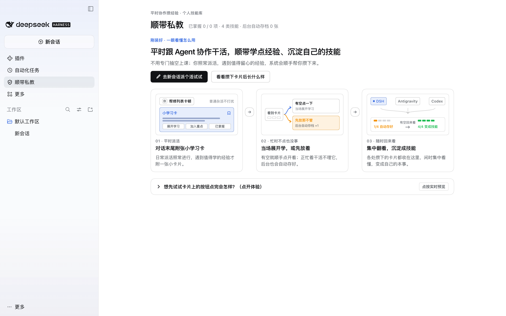

# 顺带私教 (@oxmumu3/dsh-incidental-learn)

> 作者：`牛村木木山 <157776623+oxmumu3@users.noreply.github.com>`  
> 适用宿主：`DeepSeek Harness 0.2.2-rc.2 || 0.2.2-rc.3`

平时照常跟 Agent 协作干活，顺带私教会在涉及真实工程、前端体验、AI 协作或产品策略取舍的回合末尾，附上一条默认折起的小学习卡；忙着赶进度时完全不用点任何按钮，系统会在后台静默存档；闲下来随时回到工作台，按 **前端与界面体验**、**架构与工程实践**、**AI 与 Agent 协作**、**产品与增长策略** 4 类通用技能库复习、闯关，沉淀属于自己的跨 Agent 个人技能库。

## 在 DeepSeek Harness 中安装

### 方式一：创造模式一句话安装（推荐）

1. 在 DeepSeek Harness 新建会话，点顶部「标准模式」下拉，切到「创造模式」。
2. 复制下面这句话发给 Agent，弹出授权时点「允许」：

```text
请通过插件管理器，从 npm 官方源安装并启用 @oxmumu3/dsh-incidental-learn@latest；保留已有的学习记录与技能库数据。完成后请核对版本和启用状态，再带我打开左侧「顺带私教」。
```

### 方式二：插件管理页直接添加

进入「插件 -> 添加插件」，填入 `@oxmumu3/dsh-incidental-learn@latest`，安装后点击「立即启用」，再打开左侧「顺带私教」。

## 界面与日常用法一览

### 1. 刚装好就能看懂的三步上手引导（零 Token 开箱）

首次打开默认显示三步图解，不加载虚假历史数据，也不消耗模型额度；想先看完整成效时，可一键加载不耗 Token 的示例效果随时还原。



### 2. 对话末尾默认折起的「顺带补充」，绝不抢主回复风头

仅在出现值得留心的取舍时附上一条带「附 · 顺带补充（非本轮主回复）」分隔的柔和灰单行折起条；底部输入栏轻量显示 `顺带学习 · 已存 N 张`，普通闲聊或简单改字保持完全静默。


### 3. 点开就在右侧「顺带学习栏」边聊边学，主输入框草稿原样保留

有空想弄懂时，点「在右侧边聊边学」在右侧顺带学习栏完成一题点拨，左侧正在写到一半的业务草稿原封不动；点「加入重点学」可显式挂入待学清单。


### 4. 四类通用个人技能库，集中回看、三分钟闯关与四档掌握度

按 **前端与界面体验**、**架构与工程实践**、**AI 与 Agent 协作**、**产品与增长策略** 四个通用维度自动归类，优先置顶最值得学的一张，并独立记录 `1/4` 至 `4/4 能接住追问` 的过关证据。


## 为什么不会打断干活

- **默认折起、静默优先**：对话卡片以「附 · 顺带补充」单行柔和灰收起，不遮挡也不过度提示；无实质取舍的普通问答零卡片。
- **忙时不点也在后台自动存档**：只要当轮出现取舍，卡片默认折叠也会静默写入本机「后台自动存档」清单；待看超过 5 张时出现一键清理过期低价值卡片，误删可立即撤销。
- **右侧栏与草稿双保险**：点选项自测若主输入框已有未发送草稿，绝不直接覆盖，先弹出确认条；右侧学习栏与主对话完全隔离。

<details>
<summary>开发者与进阶说明（跨 Agent CLI / 技术架构 / 本地验证）</summary>

### 1. 五格客户端槽位 (`client.js`)

- `sidebar.panellist` + `main` (`key: 'incidental-learn'`)：840px 单栏个人技能库、三步图文使用说明（0/0 空态直出、积累后可通过顶栏「使用说明」收放）、默认折叠的「效果预览」(`details` + `toolbar`) 与「后台自动存档」清单、15 分钟集中学、原生 `<dialog closedby="any">` 过关详情窗与零 Token 示例预览入口；打开旧版本账本时自动无损升级为四类通用技能维度，不丢失任何已有条目与自定义分类。
- `conversation.chat.markdown.fence` (`shield` / `learn-quiz` / `learn-pass`)：独立于 `foldCompletedTurns`，流式阶段平稳占位，定稿后就地交互；其中 `shield` 以「附 · 顺带补充」引导线 + 默认折叠柔和灰折起条呈现，未展开也同样静默写入后台存档。选项作答内置草稿保护（非空不覆盖）与空闲直发（`useInput` + `inputActions`）。
- `sidebarRightTabs` + `sidebar.right.pane.tab` (`id: '@oxmumu3/dsh-incidental-learn/coach'`, `kind: 'incidental-learn-coach'`)：右侧「顺带学习栏」边聊边学，独立升级掌握度至 `3/4 能复述`。
- `conversation.input.right`：顶部输入栏轻提醒胶囊（`顺带学习 · 已存 N 张`）。
- `tool.call.toolview`：`learn_save`、`learn_checkpoint`、`learn_triage` 紧凑单行执行回执。

### 2. 宿主侧能力 (`index.js` + `lib/`)

- 原子多进程共享账本 (`$DSH_HOME/incidental-learn/ledger.json`)：支持 `mtimeMs` 外部变更合并、临时文件 + `renameSync` 原子落盘及 15 步撤销栈。
- 静态字节预算 `systemPrompt.section`（<= 1150 UTF-8 字节），仅在 `learn_board` 工具可见时注入。
- 4 个同源工具：`learn_board`、`learn_save`、`learn_checkpoint`、`learn_triage`。
- `/api/incidental_learn/view` 与 `/api/incidental_learn/action` 同源路由（带 CSRF/Origin、Content-Type 与包体上限校验）。

### 3. 跨 Agent CLI 桥 (`bin/incidental-learn-cli.mjs`)

供 Antigravity、Codex、Claude Code 或 Super Agent 验收脚本向同一份 `ledger.json` 追加候选卡片或导出笔记：

```bash
dsh-incidental-learn add \
  --source antigravity \
  --track track-frontend \
  --title "@container 必须放在多列规则之后" \
  --why "@container 查询本身不增加选择器优先级，需放在基础网格规则之后才能在窄宽下覆盖列数" \
  --rejected "用全局 @media 查询猜测宿主分屏宽度" \
  --probe "如果在父面板同时使用 grid-template-columns 和 @container，谁写在前面会怎样？"

dsh-incidental-learn status
dsh-incidental-learn export --out ./study-notes.md
```

### 4. 本地开发与四层门禁验证

```bash
npm run build        # 将 shared/schema.js 与 src-client/* 编译为单文件 client.js
npm run check:client # 校验包名、零 ESM export、五格槽位挂载与完整卸载
npm test             # 原子账本并发、CLI、HTTP 安全校验、工具 Schema、Prompt 字节预算与词典一致性
npm run pack:release # 生成可重现 .tgz 与 .sha256
```

### 5. 安装本地离线包到 DeepSeek Harness Desktop

建议在退出当前运行的桌面端后通过官方 `dsh plugin` 安装离线包：

```bash
dsh plugin --profile desktop add ./oxmumu3-dsh-incidental-learn-0.1.6.tgz
```

</details>
