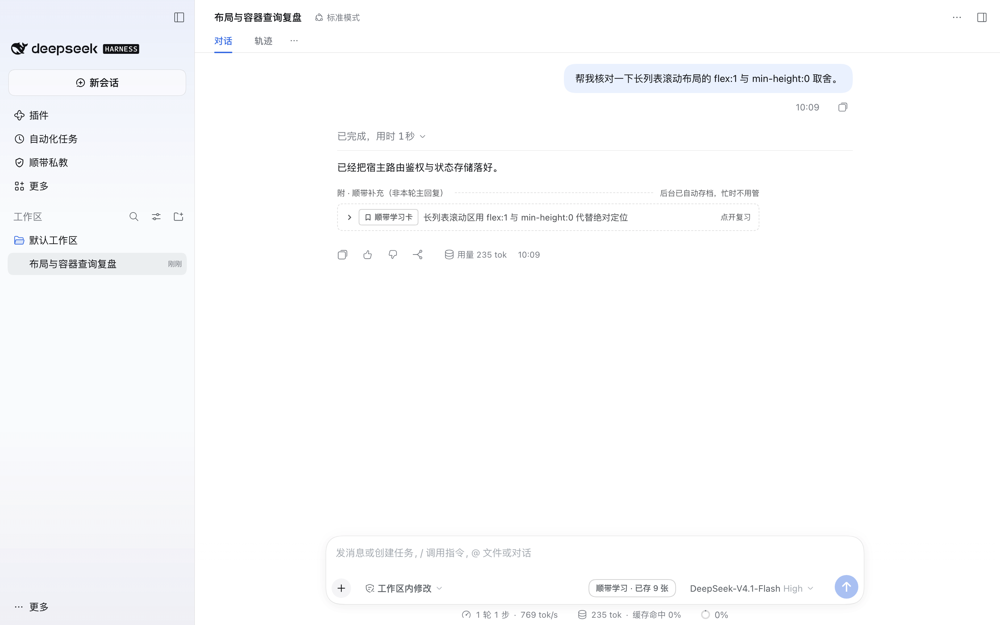
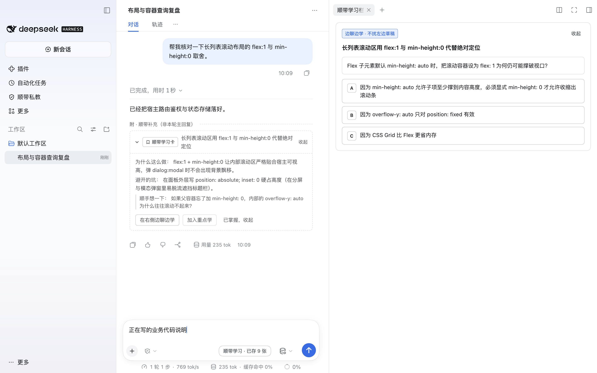
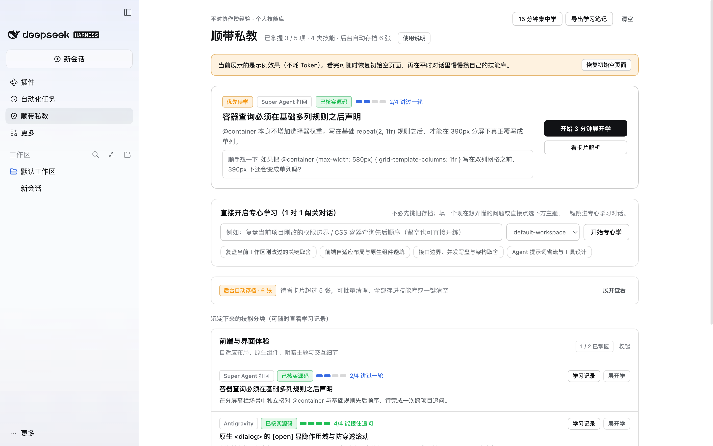

# 顺带私教 (@oxmumu3/dsh-incidental-learn)

> 作者：`牛村木木山 <157776623+oxmumu3@users.noreply.github.com>`  
> 适用宿主：`DeepSeek Harness 0.2.2-rc.2 || 0.2.2-rc.3 || 0.2.2-rc.5`

平时照常跟 Agent 协作干活，顺带私教仅在真正遇到反直觉踩坑或跨项目架构、设计取舍的回合末尾，附上一条默认折起的小学习卡；新抓到的经验直接落进唯一 **「一本手账」** 最顶部（平时 1-3 条直接铺开少点一次、第 4 条起自动折叠旧未看并设 8 条封顶防刷屏），点击行内「10 秒快测」做一道盲选题即可原地升级到 `2/4 讲过一轮` 零搬运；随时也能通过顶部输入框一键开启 1 对 1 专心闯关或从工具栏连抽 3 条串学。

## 在 DeepSeek Harness 中安装

1. 在 DeepSeek Harness 新建会话，点顶部「标准模式」下拉，切到「创造模式」。
2. 复制下面这句话发给 Agent，弹出授权时点「允许」：

```text
请通过插件管理器，从 npm 官方源安装并启用 @oxmumu3/dsh-incidental-learn@latest。完成后请核对版本和启用状态，再带我打开左侧「顺带私教」。
```

（也可以在「插件 -> 添加插件」直接填入 `@oxmumu3/dsh-incidental-learn@latest` 安装并启用。）

开源仓库与图文说明（觉得有帮助欢迎点个 Star）：  
https://github.com/oxmumu3/dsh-incidental-learn

## 界面与日常用法一览

### 1. 一体化 1 对 1 入口 + 刚装好就能看懂的三步原理图（零 Token 开箱）

首次打开保留清晰三步工作原理图与交互按钮模拟器（不加载虚假历史数据，不耗模型额度），顶部常驻「直接开启 1 对 1 专心学习」输入框，不被历史未看条卡住；积累记录后随时可通过顶栏「工作原理图」按需重看。


### 2. 对话末尾默认折起的「顺带补充」，绝不抢主回复风头

系统提示词严选只在反直觉踩坑或跨项目架构/设计取舍时附上一条带「附 · 顺带补充（非本轮主回复）」分隔的柔和灰单行折起条，单会话限频且拒绝低价值常规杂活；底部输入栏轻量显示 `顺带学习 · 已存 N 张`。



### 3. 点开就在右侧「顺带学习栏」边聊边测，主输入框草稿原样保留

有空想弄懂时，点「在右侧边聊边学」在右侧顺带学习栏完成一题盲选点拨，左侧正在写到一半的业务草稿原封不动，并顺滑留在同一本手账内。



### 4. 「一本手账」合二为一零搬运 + 三层严选防刷屏

取消独立多标签页跳转：刚抓到的条目以琥珀左边线 `0/4 新抓到 · 未看` 直接铺在手账最顶部（最多直铺 3 条，第 4 条起自动收进单行折叠条、滚动上限 8 条防刷屏，彻底不挤出下方已学技能），原地答对「10 秒快测」立即升到 `2/4 讲过一轮`；「15 分钟连考」收进工具栏动作按钮与原生模态 `<dialog>`，点击「看手卡」可随时翻阅核心取舍、避坑对照与 4 档过关证据。



## 为什么不会打断、也不会越攒越乱

- **三层防刷屏守卫**：第 1 层提示词严选 + 写入质量门禁拒收常规小修；第 2 层自动捕获未看队列按 FIFO 封顶 `8` 条；第 3 层手账首屏最多直铺最新 `3` 条，第 `4` 条起自动折进单行收纳条并支持一键清理较早旧未看（可撤销）。
- **零跨页搬运**：删掉双收件箱隔离概念，未看条、学习中、已吃透共居同一本手账，支持药丸筛选（`全部` / `新抓到未看` / `学习中` / `已吃透`）与按分类过滤。
- **右侧栏与草稿双保险**：点选项自测若主输入框已有未发送草稿，绝不直接覆盖，先弹出确认条；右侧学习栏与主对话完全隔离。

<details>
<summary>开发者与进阶说明（跨 Agent CLI / 技术架构 / 本地验证）</summary>

### 1. 五格客户端槽位 (`client.js`)

- `sidebar.panellist` + `main` (`key: 'incidental-learn'`)：920px 单栏一本手账、顶部一体化 1 对 1 专心学习入口、三步工作原理图（0/0 空态直出、积累后可通过顶栏「工作原理图」开关）、行内「10 秒快测」原地升级（`0/4 -> 2/4`）、超 3 条未看自动收纳条、药丸状态与分类筛选，以及两枚原生 `<dialog closedby="any">` 模态窗（经验手卡详单与连抽 3 条串学弹窗）；打开旧版本账本时自动无损升级为四类通用技能维度。
- `conversation.chat.markdown.fence` (`shield` / `learn-quiz` / `learn-pass`)：独立于 `foldCompletedTurns`，流式阶段平稳占位，定稿后就地交互；其中 `shield` 以「附 · 顺带补充」引导线 + 默认折叠柔和灰折起条呈现，未展开也同样静默写入手账顶部（带前端 `cardKey` Set + 后端质量门禁与 8 条封顶）。
- `sidebarRightTabs` + `sidebar.right.pane.tab` (`id: '@oxmumu3/dsh-incidental-learn/coach'`, `kind: 'incidental-learn-coach'`)：右侧「顺带学习栏」边聊边学，独立升级掌握度至 `3/4 能复述`。
- `conversation.input.right`：顶部输入栏轻提醒胶囊（`顺带学习 · 已存 N 张`）。
- `tool.call.toolview`：`learn_save`、`learn_checkpoint`、`learn_triage` 紧凑单行执行回执。

### 2. 宿主侧能力 (`index.js` + `lib/`)

- 原子多进程共享账本 (`$DSH_HOME/incidental-learn/ledger.json`)：支持 `mtimeMs` 外部变更合并、临时文件 + `renameSync` 原子落盘、自动捕获质量门禁 + 8 条滚动封顶、支持 `clear_older` 与 15 步撤销栈。
- 静态字节预算 `systemPrompt.section`（<= 1150 UTF-8 字节），仅在 `learn_board` 工具可见时注入。
- 4 个同源工具：`learn_board`、`learn_save`、`learn_checkpoint`、`learn_triage`。
- `/api/incidental_learn/view` 与 `/api/incidental_learn/action` 同源路由（带 CSRF/Origin、Content-Type 与包体上限校验）。

### 3. 跨 Agent CLI 桥 (`bin/incidental-learn-cli.mjs`)

供 Antigravity、Codex、Claude Code 或 Super Agent 验收脚本向同一份 `ledger.json` 追加候选卡片或导出笔记：

```bash
dsh-incidental-learn add \
  --source antigravity \
  --track track-frontend \
  --title "@container 必须放在多列规则之后" \
  --why "@container 查询本身不增加选择器优先级，需放在基础网格规则之后才能在窄宽下覆盖列数" \
  --rejected "用全局 @media 查询猜测宿主分屏宽度" \
  --probe "如果在父面板同时使用 grid-template-columns 和 @container，谁写在前面会怎样？"

dsh-incidental-learn status
dsh-incidental-learn export --out ./study-notes.md
```

### 4. 本地开发与四层门禁验证

```bash
npm run build        # 将 shared/schema.js 与 src-client/* 编译为单文件 client.js
npm run check:client # 校验包名、零 ESM export、五格槽位挂载与完整卸载
npm test             # 原子账本并发、质量门禁、8条滚动封顶、行内快测原地升级、CLI、HTTP 安全校验、词典与零 Emoji
npm run pack:release # 生成可重现 .tgz 与 .sha256
```

### 5. 离线打包测试（仅限开发者维护脚本）

```bash
dsh plugin --profile desktop add ./oxmumu3-dsh-incidental-learn-0.2.0.tgz
```

</details>
